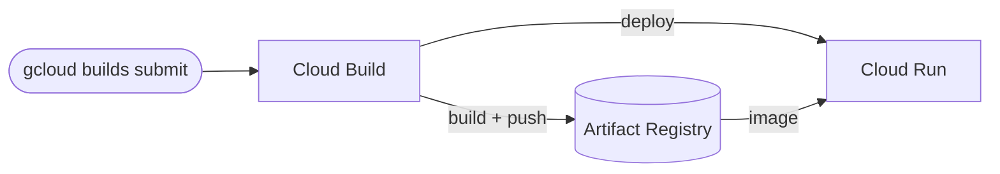

# GCP CI/CD with Cloud Build (Terraform)

> Terraform provisions Artifact Registry + Cloud Run and the Cloud Build permissions; `cloudbuild.yaml` builds, pushes, and deploys on every build.
> **Author:** Muhammad Ahmad · **IaC:** Terraform · **Cloud:** GCP


---

## 📌 Overview

- **Artifact Registry** (Docker) stores the application images.
- **Cloud Run** is the deploy target (starts on a placeholder image).
- **Cloud Build** permissions (`run.admin`, `iam.serviceAccountUser`, `artifactregistry.writer`) are granted to the Cloud Build service account.
- `cloudbuild.yaml` builds the image from `./app`, pushes it, and deploys to Cloud Run.

## 🏗️ Architecture



## 🚀 Deploy

```bash
cd terraform
gcloud auth application-default login
terraform init
terraform apply -var="project_id=YOUR_PROJECT_ID"

# From the repo root, run a build + deploy:
terraform -chdir=terraform output -raw submit_build_command
```

## 🧹 Clean up

```bash
cd terraform && terraform destroy -var="project_id=YOUR_PROJECT_ID"
```

## 🔐 Production hardening (next steps)

- Add a **Cloud Build trigger** on your Git repo for automatic builds.
- Deploy with a **dedicated runtime service account**.
- Add approval gates and a **staging** Cloud Run service.

---

*Built and maintained by **Muhammad Ahmad**.*
