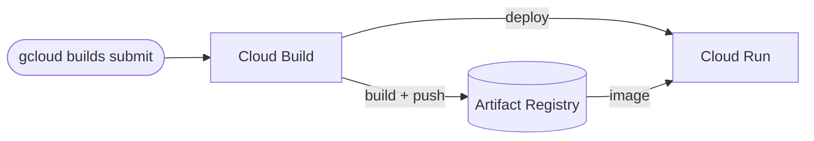

# Architecture Diagram — GCP CI/CD with Cloud Build

## Lucid diagram

- **View:** https://lucid.app/lucidchart/512c0fd1-4a64-4e9b-97b2-7f863f88638e/view
- **Edit:** https://lucid.app/lucidchart/512c0fd1-4a64-4e9b-97b2-7f863f88638e/edit

## Lucid prompt (reusable)

```
Create a GCP CI/CD diagram titled "GCP CI/CD with Cloud Build".
A developer runs gcloud builds submit, triggering Cloud Build. Cloud Build builds and
pushes an image to Artifact Registry, then deploys to Cloud Run; Cloud Run pulls the
image from Artifact Registry. Label the arrows. Clean, professional Google Cloud colors.
```

## Mermaid source


